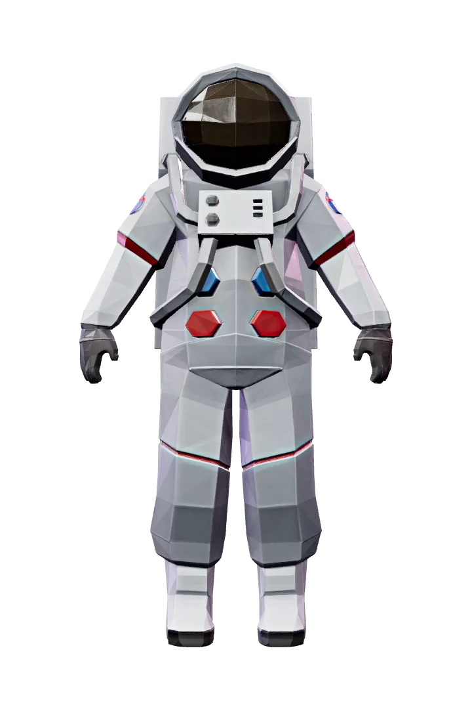

# Pip's Thought Orbit

<p align="center">
  
</p>

**You don't have to remember everything.** Pip's Thought Orbit is a mixed reality focus companion for Meta Quest. Park a thought and it becomes a glowing orb circling Pip. When you're ready, bring one thought into focus and work on it on a glass board in front of you.

Built with Meta's [Immersive Web SDK](https://github.com/meta-quest/immersive-web-sdk) (WebXR, hand tracking, passthrough AR) as a Semester 7 AR/VR project at MIT-WPU.

## What it does

- **Park a thought.** Type an intention on the home panel and press **Park**. It joins Pip's orbit as an orb.
- **Place Pip.** Point at a surface, then hold up an open palm (like "stop") to place Pip in your room.
- **View an orb.** Pinch an orb to open its card.
- **Focus Mode.** Grab an orb and drop it in the glowing ring in front of Pip (or choose **Focus** on its card). A glass thinking board opens while Pip, the other orbs and the sky dim and step back.
- **Work on the board.** Add sticky notes and sub-task orbs, then choose **Back to Orbit** (or pull the orb off the board) to save and return.
- **Calm space.** A midnight-indigo sky dome with nebula and stars covers the room. Hide it to see passthrough.
- **Spatial sound.** All sounds are synthesised with the Web Audio API and positioned where they happen (HRTF panning). No audio files.
- **Saved locally.** Thoughts and their workspaces are kept in `localStorage`, in the same format as the web prototype.

## Repository layout

| Path | What's there |
|---|---|
| `index.html` | Home panel (park a thought, enter Pip's space) |
| `src/index.js` | App entry point; registers systems |
| `src/pip-system.js` | Pip, the orbit of thought orbs, placement and interaction |
| `src/focus-mode.js` | Focus Mode: the focus ring and glass board |
| `src/workspace-items.js` | Sticky notes and sub-tasks on the board |
| `src/tasks.js` | Parked thoughts and storage |
| `src/cosmos.js` | Sky dome, nebula and stars |
| `src/sound.js` | Synthesised spatial sound |
| `src/scene-assets/pip.scene-asset.js` | Procedural Pip model |
| `public/ui/*.uikitml` | In-headset UI panels (task card, HUD, focus board, note editor) |
| `public/scenes/` | Authored IWSDK scene |
| `web-app/` | Earlier single-file browser prototype with its image and SVG assets |
| `assets/` | Pip character art, the optimised 3D model (`.glb`) and turntable animation |
| `docs/` | UX case study (PDF) |

## Run it

Requires Node.js 20.19+, 22.12+ or 24+.

```bash
npm install
npm run dev
```

This starts the IWSDK dev server with an emulated headset in the browser. To try it on a Quest, open the dev server URL in the Quest browser and press **Enter Pip's space**.

Build for production:

```bash
npm run build
```

The web prototype in `web-app/` has no build step: serve the folder (for example `python3 -m http.server`) and open `index.html`.

## Tech

- [@iwsdk/core](https://www.npmjs.com/package/@iwsdk/core) (ECS on three.js) with hand tracking and hit testing
- [@pmndrs/uikit](https://github.com/pmndrs/uikit) for spatial UI
- Vite
- Web Audio API

## Author

Turiya Joshi
